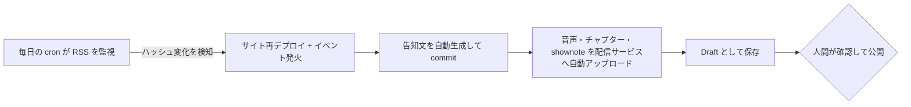
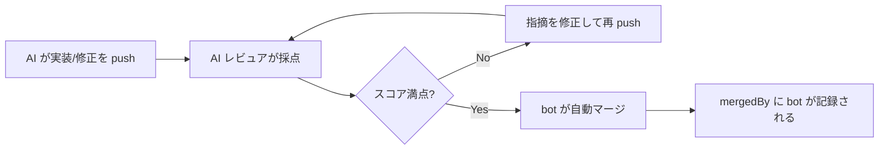

# TL;DR

- 個人リポジトリ 3 つ（ポッドキャスト運用 / 個人サイト運用 / 収益化ツール開発）を実験場に、企画からマージ・運用までの開発プロセスを AI に自律実行させる仕組みを 1 ヶ月半かけて組みました
- 権限は最初から渡さず、**Can（届く範囲）/ May（実行時の承認）/ Act（ゲートを通って初めて効力を持つ）** の 3 層で段階的に earn させる設計にしています
- マージ条件を機械可読にした結果、AI レビュアのスコアが 0/5 → 3/5 → 5/5 と収束し、**人間が 1 行も書いていない PR が bot によって自動マージされる**ところまで到達しました
- うまくいった話だけでなく、macOS の権限で cron が全滅した話や、レビュー用スキル自身が「自分が他 PR で指摘したのと同じ違反」を犯していた話も含めて、失敗から得たガードレール原則を部品表として整理します
- 結果として、開発ツール側のリポジトリは直近 80 コミット中 73 コミット（91%）が Claude 共著になりました

# 背景 — 個人リポジトリ 3 つを「AI 前提組織」の実験場にした

私は普段 PM をしていて、AI エージェントを開発プロセスに組み込む仕事をしています。以前の記事で、リポジトリを AI が働きやすい形に整える話（SSOT 化と Claude Skills）を書きました。

https://zenn.dev/yukamiya/articles/pm-ssot-claude-skills

今回はその続きです。土台を整えた後、「では実際にどこまで任せられるのか」を確かめるために、性質の違う個人リポジトリ 3 つで数ヶ月にわたって自律実行の仕組みを積み上げてきました。

| リポジトリ | 性質 | AI に任せたいプロセス |
| --- | --- | --- |
| momit.fm | ポッドキャストサイト（コンテンツ運用） | エピソード公開のたびに発生する定型リリース作業 |
| yukamiya.me | 個人サイト（静的サイト運用） | コンテンツ更新の検知・QA・レビュー・マージ |
| hub.momit.fm | ブログ + 収益化ツール（ツール開発） | ツール実装そのものと、PR レビュー・修正・マージ |

正直に言うと、試行錯誤を重ねるうちに自分でも全体像が分からなくなりました。この記事は、3 リポジトリのコミットログ・PR 履歴・Claude Code のセッションログ（3 プロジェクト合計で 20 セッション、約 38MB）をたどって書いています。登場する数値やコミットはすべて実記録からの引用です。

書きたいのは個々のツールの使い方ではありません。**AI に自律実行させる組織を作るとき、権限をどう制御し、マージ条件をどう定義し、どこにガードレールを置くか**。この 3 点を、自分の環境に持ち帰れる粒度で残すのがこの記事の目的です。

# 権限設計 — Can / May / Act の 3 層モデル

今年 UC Berkeley の Agentic AI Summit に参加したとき、印象に残った言葉があります。「エージェントはデプロイした瞬間に全権限を得る。これは design error だ」。権限は与えるものではなく earn させるもの、という話でした。

3 リポジトリでやってきたことを振り返ると、権限の制御は自然と 3 層に分かれていました。

## Can — そもそも届く範囲を絞る

エージェントが物理的に到達できるツール・コマンド・ドメインの範囲です。実装はすべて宣言的な allowlist でした。

- Claude Code の `settings.local.json` — 許可コマンドを `git worktree:*` や `gh api:*` のように前方一致で列挙。WebFetch はドメイン単位
- GitHub Actions 上のエージェントは workflow 定義の `--allowed-tools` で絞る。たとえば QA 用のジョブは `Read, Grep, Glob, WebFetch, gh issue create` 程度しか持ちません
- 認証情報そのものを渡さない選択もここに入ります。アフィリエイトサービスへのログインは Playwright でブラウザを開くところまでを AI がやり、ログイン操作は人間。パスワードは保存しません

## May — 実行の瞬間に承認を挟む

Can の範囲内でも、実行時に別の判断者を通す層です。

- Claude Code の auto モードには危険操作を止める分類器がいて、本番 WordPress への書き込みコマンドは実際にブロックされました。最終的にそのコマンドは私が自分の手で実行しています
- GitHub 上では author-association によるゲート。`@claude` メンションに反応する workflow は OWNER / MEMBER / COLLABORATOR のコメントにしか反応しません
- fork からの PR は信頼度を落とします。後述する自律レビューは、fork PR を検知すると修正 push を諦めてレビューコメントのみに自動降格します

## Act — 成果物はゲートを通って初めて効力を持つ

AI が作った成果物を、そのまま「効力のある状態」にしない層です。ここが一番設計しがいがありました。

- ポッドキャストの音声アップロードは全自動で進みますが、配信プラットフォーム上では **Draft として保存**されます。公開ボタンは人間しか押しません
- ライブサイトへの書き込みを持つ CLI は **dry-run が既定**で、`--apply` を明示したときだけ実書き込み。しかも POST の前に必ず編集前スナップショットをバックアップに残します
- そしてマージ。これは次々節で詳しく書きますが、機械可読な条件を満たした場合のみ bot がマージします

3 層に分けて眺めると、「AI に自由にやらせる」と「全部人間が確認する」の二択ではないことがはっきりします。層ごとに緩めたり締めたりできるダイヤルが 3 つある、という感覚です。

# 開発プロセス別の自律度マップ

3 リポジトリの実装を、開発プロセスのフェーズごとに「AI がやること / 人間に残したこと / 境界を守る仕組み」で並べたのがこの表です。

| フェーズ | AI がやること | 人間に残したこと | 境界を守る仕組み |
| --- | --- | --- | --- |
| 企画・生成 | エピソードのタイトル案 10 本、shownote、チャプター、告知文の生成（momit.fm） | 案の採否 | 生成物はファイル・Draft 止まり |
| 実装 | 機能実装・バグ修正・テスト作成。レビュー指摘の修正 commit を PR ブランチに push（hub.momit.fm） | 仕様の決定、PR の作成判断 | テストゲート（後述）を通らないと push しない |
| レビュー | 3 観点の並列レビュー → 検証 → inline コメント投稿（hub.momit.fm）、`AUTO_REVIEW_STATUS` を出す自動レビュー（yukamiya.me） | 指摘への反応（👍/👎/revert） | 検証ゲートで確信度 80 未満の所見は投稿前に棄却 |
| マージ | 条件を満たした PR の自動マージ | 条件未達 PR のマージ判断 | 機械可読なマージ条件（次節） |
| デプロイ | push 起点の自動デプロイ、デプロイエラーの検知と修正 | 本番環境の環境変数・公開設定 | デプロイ手順書から `--allow-unauthenticated` を排除 |
| 運用・QA | RSS 更新の検知 → サイト再デプロイ → 告知文生成（momit.fm）、デプロイ後 QA と Issue 自動起票（yukamiya.me）、週次のリンク切れ検査とレポート生成（hub.momit.fm） | Issue の取捨、公開判断 | QA の起票はテンプレート + 重複排除ルール付き |
| 学習 | レビュー実行記録の蓄積、人間の反応からのルール抽出、誤検知パターンの記憶 | ルールの妥当性確認 | 学習ルールには証拠（コメント ID や revert SHA）の引用を必須化 |

運用フェーズの例として、ポッドキャストの新エピソード公開はこう流れます。人間が触るのは最後の公開ボタンだけです。

フェーズによって任せ方の濃淡がかなり違います。生成系はほぼ全部任せて Draft で受け止める。実装とレビューはゲート付きで任せる。マージは条件を機械化した上で bot に渡す。公開・課金・環境変数のような不可逆または高リスクの操作は最後まで人間、という分布に落ち着きました。

# マージ条件の設計 — 「満点なら通す」を機械可読にする

自律実行の仕組みで一番面白かったのがここです。マージは Git 履歴に永続する不可逆寄りの操作なので、最後まで人間に残すか迷いました。最終的には「**条件を機械可読に書き切れるなら bot に渡せる**」という整理をしています。

## 2 つの実装

yukamiya.me では 3 条件の AND を取っています。

1. Greptile（サードパーティの AI レビュア）の Confidence Score が 5/5
2. GitHub の required checks がすべて green
3. 自前の自動レビュー workflow が機械可読マーカー `AUTO_REVIEW_STATUS: pass` を出力している

hub.momit.fm では GitHub Actions の workflow（greptile-gate）として実装しました。PR への push ごとに起動し、Greptile のスコア投稿を待ち、`Confidence Score: X/5` をパースして、満点なら `gh pr merge` を実行します。

ポイントは 3 つあります。

- **判定材料をコメント本文という自然言語から正規表現で抜ける形に固定した**こと。AI レビュアの出力に「機械可読な一行」を要求するのは、AI 前提のプロセス設計でかなり効く小技です
- **same-repo の PR に限定した**こと。fork PR は GITHUB_TOKEN が read-only になる仕様に乗って、ゲート自体が対象外になります
- **bot マージは監査可能**なこと。GitHub 上で mergedBy が `app/github-actions` と記録されるので、後から「誰が通したか」を一切曖昧にしません

## マージ条件は改善圧力になる — スコア収束の実録

このゲートが最初に本番で捌いたのは、皮肉なことに「自律レビューのスキル自体を追加する PR」でした。経過をそのまま載せます。

| イテレーション | Greptile スコア | 何が起きたか |
| --- | --- | --- |
| 1 | 0/5 | ブランチ名のシェル未検証、fork PR の誤 push リスク、学習記録の取りこぼし、の 3 指摘。全部妥当でした |
| 2 | 3/5 | 修正したつもりが「規約としては書いたのに、コマンド例文が未反映」と差し戻し |
| 3 | 5/5 | 例文まで直して満点。ゲートがスコアをパースし、そのまま自動マージ |

人間の私がやったのは方針の判断と、再レビューの号令だけです。「満点になるまでマージされない」という条件が、そのまま修正を促す圧力として働きました。マージ条件は関所であると同時に、AI にとっての改善のフィードバック信号でもある。これは組んでみて初めて腹落ちした点です。

# ガードレール原則集（ハーネスの部品表）

3 リポジトリを横断して効いていたガードレールを、部品表として並べます。どれも単体では地味ですが、組み合わせて初めて「安心して任せられる」状態になりました。

| 原則 | 実装例 | 守っているもの |
| --- | --- | --- |
| dry-run 既定 + 明示 `--apply` | ライブ WordPress 書き込み CLI | 本番コンテンツ |
| 実行前バックアップ | POST 前に編集前 HTML をスナップショット | 可逆性 |
| Draft を人間の関所に | 音声アップロードは Draft 保存まで | 公開の最終判断 |
| 1 finding = 1 commit | レビュー修正は所見ごとに commit を分割 | 人間の revert がそのまま「この修正は不要」という学習シグナルになる |
| 敵対的検証による自己棄却 | レビュー所見を懐疑役エージェントが実コードで反証し、確信度 80 未満は投稿しない | レビューコメントの信頼性。実運用 2 回で過大な主張 4 件を再現実験つきで棄却できました |
| テストゲートは失敗集合の比較 | 修正前後で failing テストの集合を比較し、増えていなければ通す | 「既知の失敗 7 件」をハードコードせずに回帰ゼロを判定できる |
| 状態と記憶はリポジトリにコミット | 自動化の状態ファイル・誤検知メモをリポジトリ内に置く | クラウド実行やマシン移行をまたいだ継続性 |
| secret スキャン hook | commit 前に認証情報の混入を検査 | 秘匿情報 |
| 自己トリガー防止 | 自動起票された Issue にはメンション応答 workflow が反応しない | エージェント同士の無限ループ |

このうち「1 finding = 1 commit」と「状態はリポジトリに」は、AI 前提だからこそ出てくる設計だと思っています。前者は人間の操作（revert）を機械が読める学習データに変える仕掛けで、後者は「セッションが消えても賢さが残る」ための置き場所の問題です。

# 失敗から学んだこと

うまくいった話より、失敗の方が設計原則をくれました。4 つ挙げます。

**macOS の権限で週次 cron が 18 日間サイレントに全滅した。** launchd に登録した週次ジョブが `Operation not permitted` で失敗し続けていました。原因は TCC（macOS のプライバシー保護）で、手動実行では正常だから気づかない。ログを見る仕組みだけ作って、ログを見る習慣を作っていませんでした。自動化の死活監視はそれ自体を自動化しないと意味がない、という教訓です。

**外部サービスの未文書化挙動でゲートがタイムアウトした。** Greptile はドキュメント追記だけの push に対して、新しいレビューオブジェクトを作らずサマリコメントを in-place 更新して採点することがあります。レビューオブジェクトの出現だけを待っていたゲートは、満点が出ているのに永久に気づけませんでした。対処は検知の 2 系統化（レビューオブジェクト or コメント更新時刻）。外部サービスの挙動は必ず想定外を踏む前提で、判定材料を単線にしないことにしました。

**レビュー用スキル自身が、自分が他 PR で指摘したのと同じ違反を犯していた。** 自律レビューは他の PR で「ユーザー固有の絶対パスをハードコードするな」と指摘し修正までしたのに、そのスキル自身の手順書に絶対パスが直書きされていました。見つけたのは自分ではなく外部の AI レビュアです。自己検証には構造的な盲点がある。マージ判定を自分と独立した評価者に置いた設計は、ここで効きました。

**シェル注入と fork 誤 push の指摘を外部から受けた。** 「PR のブランチ名は攻撃者が自由に付けられる入力である」という視点が、個人リポジトリの感覚では抜けていました。public リポジトリで自律実行させるなら、PR メタデータはすべて信頼できない入力として扱う。ブランチ名の形式検証とクォート必須化、fork PR の権限自動降格をここで入れています。

# 組織に持ち込むなら何から始めるか

個人リポジトリでの検証なので、単独開発者・小規模という限界は先に書いておきます。合意形成やコンプライアンスのレイヤーは今回の範囲外です。それでも、導入の順序としては次の 3 段階が再現しやすいと感じています。

1. **Can と Act から始める。** allowlist で届く範囲を絞り、成果物の受け口を Draft / dry-run にする。ここまでは既存のレビュー体制を一切変えずに導入でき、事故っても戻せます
2. **マージ条件を機械可読にする。** いきなり自動マージまで行かなくても、「AI レビューの結果を 1 行のマーカーで出す」だけでプロセスが監査可能になります。閾値を上げ下げできるダイヤルを先に作る、という発想です
3. **学習の置き場所を決める。** 実行記録・誤検知メモ・学んだルールをリポジトリにコミットする運用にすると、セッションや担当者が変わっても賢さが積み上がります。ルールに証拠の引用を必須にすると、後から「なぜこのルールがあるのか」を追えます

# まとめ

最終的な分担はこうなりました。

| | AI が自律実行 | 人間が保持 |
| --- | --- | --- |
| 生成・実装・レビュー・修正 | ◎（ゲート付き） | 仕様と方針の決定 |
| マージ | ◎（機械可読条件の充足時のみ） | 条件未達時の判断、条件そのものの設計 |
| デプロイ・運用・QA | ◎（検知・起票・レポートまで） | 公開ボタン、環境変数、課金に関わる操作 |
| 学習 | ◎（記録と抽出） | ルールの最終的な妥当性確認 |

まだ終わっていない部分もあります。人間の 👍/👎 や revert をルールに変換する学習ループは仕組みだけ作って初回実行前ですし、「実績に応じて自律度を段階昇格させる」運用も明文化の途中です。このあたりは動かしてから続編で書きます。

AI に任せる範囲を広げる作業は、突き詰めると「信頼の条件を言語化してコードにする」作業でした。曖昧に信頼するのでも、曖昧に警戒するのでもなく、条件を書く。書けた分だけ任せられる。3 リポジトリ分のログを振り返って、それが一番の収穫だったと思います。

# 参考

- 前提となる土台づくりの話: https://zenn.dev/yukamiya/articles/pm-ssot-claude-skills
- Human-in-the-loop 設計の話: https://zenn.dev/yukamiya/articles/ai-evidence-judgment
- Greptile: https://www.greptile.com/
- Claude Code GitHub Actions: https://github.com/anthropics/claude-code-action
