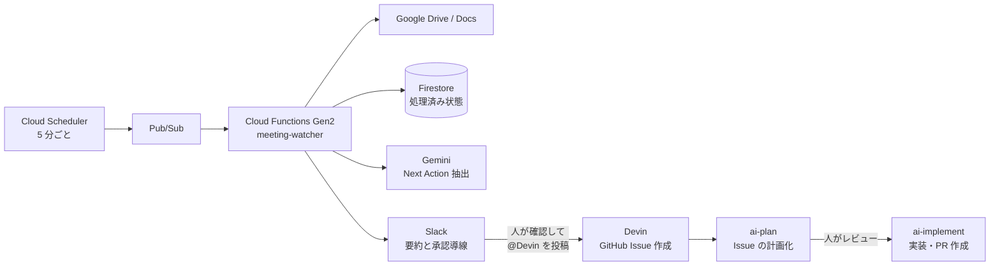

開発会議のあとに残る「誰かが Issue にしておく」は、ささやかですが抜けやすい仕事です。

今回、この作業を減らすために `meeting-watcher` を作りました。Google Docs の議事録から実行すると決まった Next Action を Gemini で抽出し、Slack に届けます。ただし、Slack 投稿から Issue 作成までを自動でつなぐのではありません。人が内容を確認し、明示的に承認してから後続の自動化を動かす設計です。

この記事では、議事録から Pull Request までの全体像と、運用で効いてくる設計判断を紹介します。

## 何を自動化し、何を人に残すか

目標は、議事録を読んでタスクを転記する手作業をなくすことです。一方で、次の判断は人に残します。

- 抽出された Next Action が本当に Issue 化すべき内容か
- Issue の背景や完了条件が、チームの認識と合っているか
- 実装を自動化へ渡してよいか

この境界を守るため、`meeting-watcher` は Issue を直接作成しません。Slack への通知と、承認後に使う指示文の提示までを担当します。



## 処理の流れ

Cloud Scheduler が 5 分ごとに Pub/Sub のトピックへ空のメッセージを送ります。Cloud Functions Gen2 はそれをトリガーとして起動し、以下を順に処理します。

1. Google Drive から、タイトルに `見極めAI` を含み、直近 24 時間に更新された Google Docs を検索する
2. Firestore を見て、同じバージョンの文書を処理済みでないか確認する
3. Google Docs API で本文をプレーンテキストとして取得する
4. Gemini に Next Action を JSON で抽出させる
5. 抽出結果と議事録へのリンクを Slack に投稿する
6. Slack 投稿が成功したときだけ、Firestore に処理済みとして記録する

検索キーワードと対象時間は環境変数で変更できます。5 分ごとの実行で毎回「過去 24 時間」を検索しても、Firestore に文書 ID と最終更新時刻を保存しているため、同じ内容を繰り返し通知しません。逆に議事録が更新された場合は、更新版としてもう一度処理されます。

## Google Docs へのアクセスはユーザー OAuth にする

Cloud Function から Google Drive を読むとき、最初に考えたのはサービスアカウントでした。しかし組織のポリシー上、`*.iam.gserviceaccount.com` に議事録を共有できません。

そこで Drive と Docs の読み取りには、議事録の閲覧権限を持つ本人の OAuth refresh token を使います。refresh token と OAuth クライアント情報は Secret Manager に保管し、関数の実行時に取得します。

```python
credentials = Credentials(
    token=None,
    refresh_token=refresh_token,
    token_uri=block["token_uri"],
    client_id=block["client_id"],
    client_secret=block["client_secret"],
    scopes=[
        "https://www.googleapis.com/auth/drive.readonly",
        "https://www.googleapis.com/auth/documents.readonly",
    ],
)
```

ここで重要なのは、関数の実行権限までユーザー OAuth に寄せていない点です。Firestore、Secret Manager、Cloud Functions の実行自体は専用のサービスアカウントが担当します。ユーザー OAuth は「そのユーザーとして Docs を読む」という、必要な範囲だけに閉じています。

OAuth refresh token が失効した場合は例外を握りつぶさず、Slack に復旧手順付きのアラートを投稿します。正常時の通知と違い、このアラートには Issue 作成につながる文言を含めません。

## Gemini には自由文ではなく構造化データを返してもらう

議事録からタスクを抜き出すだけなら、要約を返してもらう方法もあります。しかし後段で Slack 表示や Issue 作成に使うなら、フォーマットが揺れると扱いにくくなります。

`meeting-watcher` では Gemini の JSON schema を指定し、各 Next Action を次の形で受け取ります。

```json
[
  {
    "title": "評価結果の通知テンプレートを追加する",
    "description": "Slack 通知の文面をテンプレート化し、失敗時の再送方針を明記する",
    "priority": "high",
    "assignee": "山田",
    "due_date": "2026-10-23"
  }
]
```

抽出プロンプトでは「議論しただけの項目は除外し、実行すると決まったものだけ」「1 Action を 1 Issue として独立実装できる粒度にする」と定義しています。temperature は `0.0` に固定し、同じ議事録からの揺れを抑えます。

また、入力が異常に大きくなったときにコストとレイテンシが跳ねないよう、議事録本文は 50,000 文字で打ち切ります。Gemini の呼び出しに失敗した場合や、応答が JSON として読めない場合、期待した配列でない場合は、空の Action として扱います。このとき Slack には「Next Action は抽出されませんでした」と投稿され、その版は処理済みになります。議事録が更新されるまで自動では再試行されないため、抽出漏れに見えたときは人が議事録を見直す前提です。

## 冪等性は「Slack 投稿成功後」に記録する

定期実行では、失敗しても次の実行で自然に回復できることが大切です。

処理済みの記録を Slack 投稿より先にしてしまうと、Slack 側の一時障害で通知に失敗した文書が二度と処理されません。そのため、順序を次のように固定しています。

```text
Drive から候補取得
  → Firestore の処理済み確認
  → Gemini 抽出
  → Slack 投稿
  → 成功した場合だけ Firestore に記録
```

Slack Webhook には、ネットワークエラーや 5xx に対する指数バックオフのリトライを入れています。一方で 4xx は設定ミスや認可エラーの可能性が高いため、無駄にリトライせず失敗として残します。いずれも処理済みにはならないので、次の定期実行で再試行できます。

## 「@Devin を投稿しない」ことが承認ゲートになる

Slack の通知には、抽出された Next Action の一覧とともに、Issue を作成するための `@Devin` 向け指示文をコードブロックで表示します。

ここでのポイントは、関数自身が `@Devin` をライブメンションしないことです。コードブロック内の指示を人がコピーして Slack スレッドへ貼り付けるまでは、Devin は動きません。

このひと手間には、次の役割があります。

- 抽出漏れや誤解釈を、人が Issue 化の前に止められる
- 複数の Next Action のうち、今は起票しないものを除外できる
- Slack の自動通知が意図せず開発フローを進める事故を防げる

人が承認すると、Devin は対象リポジトリに `ai-plan` ラベル付きの Issue を作成します。続いて GitHub Actions がリポジトリを調べ、背景・実装計画・検証方法を含む Issue 本文へ具体化します。この計画も人がレビューし、問題なければ `ai-implement` ラベルを付けて実装と Pull Request 作成に進めます。

つまり、AI が得意な「情報の抽出」「リポジトリ調査」「定型作業」は自動化しつつ、優先順位と実装方針を確定する節目には、人の確認を置いています。

## シークレットとデプロイの考え方

Slack Webhook、Gemini API キー、OAuth クライアント情報、refresh token はすべて Secret Manager に置きます。シークレットをアプリケーションプロセス内でキャッシュしないのも意図的です。Webhook の再発行や token のローテーション後に、長く生きた Cloud Function インスタンスが古い値を使い続けないようにするためです。

デプロイは GitHub Actions から Workload Identity Federation（WIF）で行います。GCP のサービスアカウントキーを GitHub Secrets に保管せず、GitHub Actions の OIDC トークンを使って短期認証情報を得ます。リポジトリとブランチの条件を設定できるので、長期鍵を配らずにデプロイできます。

ランタイムのサービスアカウントには、Firestore と必要な Secret へのアクセスだけを付与します。Drive / Docs に必要なのは前述のユーザー OAuth のみです。認証経路が二つあるため少し複雑に見えますが、権限の目的を分けることで、不要に広いアクセス権を避けられます。

## まとめ

`meeting-watcher` は、議事録から開発タスクへ進む入口を自動化する仕組みです。

- 5 分ごとに更新済みの議事録を見つける
- Gemini の構造化出力で Next Action を抽出する
- Firestore で重複通知を防ぎ、失敗時は次回に再試行する
- Slack に可視化するが、Issue 化には人の明示的な承認を求める
- 承認後も `ai-plan` と `ai-implement` の間にレビューを挟む

会議の内容をそのまま自動実装に流すのではなく、「抽出 → 承認 → 計画化 → レビュー → 実装」と段階を分けることで、作業の取りこぼしを減らしながら、チームの意思決定は人が握れるようにしました。

次の改善候補は、抽出品質を継続的に評価できるようにすることと、Slack 上での承認体験をさらに分かりやすくすることです。運用の中で人がどこで迷うのかを観察しながら、承認ゲートを軽く、しかし確実なものにしていきます。
