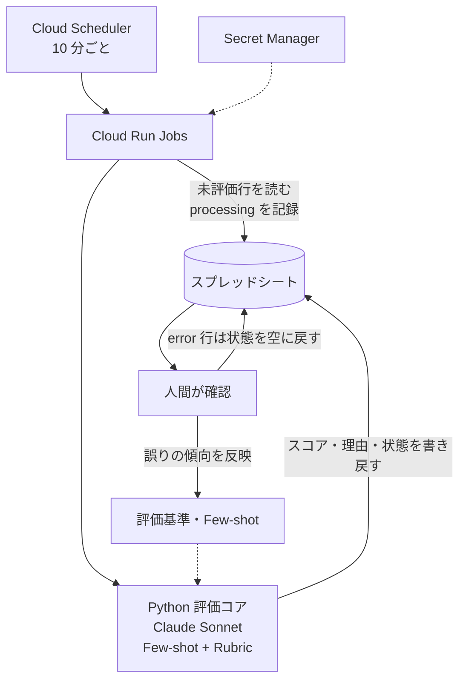

# TL;DR

- とある負荷の高い人事オペレーションのレビューに LLM を入れ、人間の詳細レビューを 50% 程度減らすことを目標にしました。AI に返させるのは `0〜3` のスコアと理由だけで、どの対象のレビューを省くかは人間が決めます。
- Gemini / Claude / GPT 系の 3 モデルを比較したところ、どのモデルも評価基準だけより Few-shot を足した構成の方が精度が上がりました。本番は Claude Sonnet + Few-shot + Rubric で動かしています。
- 一致率が高くても、通過ラインをまたぐ誤りは別に測る必要があります。評価カテゴリによっては、一致率 64% でも高評価の半数を取りこぼしていました。

対象は人事領域のオペレーションです。機微な内容を含むため具体的な業務名は伏せ、ベンチマークと Human-in-the-loop 設計の実装と検証に絞って書きます。

# 設計方針: AI はスコアと理由だけを返す

人事オペレーションのような高リスクなレビューで AI に最終判定まで出させると、判断根拠が曖昧なまま結果だけが残ります。モデルやプロンプトを変えれば判断も揺れますし、誤判定したときに人間がどこを見直せばよいかも分かりません。

そこで AI の出力を、評価基準に沿ったスコア `0〜3` と、200〜300 字を目安にした理由テキストに絞りました。キー名は記事用に一般化しています。

```json
{
  "score": 2,
  "reason": "評価基準に照らすと、主要な要件を満たしており、具体的な根拠も確認できる。再現性や継続性を判断するには追加確認が必要な点が残るため、最高評価ではなく2点とした。"
}
```

出力をこの形にそろえると、Exact Match、±1 許容、MAE といった基本指標でモデルを比べられます。オペレーション担当者とも「これは 2 点か 3 点か」「この理由に納得できるか」という具体的な形で議論できます。

もう 1 つ決めたのが、正解を入力に入れないことです。検証データには、人間が後から付けた基準値やコメントがあります。これをプロンプトに含めると、精度が高く見えても実際には答えに寄せているだけかもしれません。入力に使うのは、実際の運用時に手に入る本文と関連 URL、評価基準、別の対象から選んだラベル付きの few-shot 例だけです。

# ベンチマーク: Few-shot が効いた

評価対象・入力・評価基準・few-shot 方針をそろえ、3 モデルと 2 つのプロンプト構成を比較しました。使った構成は `gemini-3-pro`、`claude-sonnet-4-6`、`gpt-5-4` です。数値は実行時点の記録を丸めたものです。

| Model family | Prompt pattern | Exact Match | Within ±1 | MAE | 平均処理時間/件 |
| --- | --- | ---: | ---: | ---: | ---: |
| Gemini family | Few-shot + Rubric | 約 55% | 約 94% | 約 0.51 | 約 19秒 |
| Gemini family | Rubric-only | 約 52% | 約 96% | 約 0.52 | 約 21秒 |
| Claude family | Few-shot + Rubric | 約 52% | 約 93% | 約 0.55 | 約 32秒 |
| Claude family | Rubric-only | 約 36% | 約 90% | 約 0.74 | 約 9秒 |
| GPT family | Few-shot + Rubric | 約 51% | 約 94% | 約 0.55 | 約 8秒 |
| GPT family | Rubric-only | 約 45% | 約 91% | 約 0.64 | 約 6秒 |

3 モデルとも、Few-shot + Rubric の方が Exact Match と MAE で良い結果でした。差が大きかったのは Claude で、Exact Match が約 16pt 上がっています。

このオペレーションの評価基準は、文章で書いても解釈の余地が残ります。人間同士でも 1 点か 2 点かで意見が割れるくらいなので、LLM がどの程度の根拠をどのスコアに対応させるかで揺れるのも自然です。few-shot の例は、その対応関係を AI とオペレーション担当者の間で合わせる校正データとして効いたのだと考えています。

数値だけなら Gemini の Few-shot + Rubric が最も良い結果でした。それでも本番に Claude Sonnet + Few-shot + Rubric を選んだのは、理由テキストがオペレーション担当者にとって読みやすかったことと、コスト効率を考慮したためです。

# 一致率だけでは足りない: 通過ラインをまたぐ誤りを見る

運用方針では、AI の予測スコア `pred` が 2 以上なら、詳細レビューを省いて通過させる対象にします。人間の基準値を `GT` とすると、同じ 1 点のズレでも、通過ラインの 2 点をまたぐかどうかで影響が変わります。

| GT → pred | 起こり得ること |
| --- | --- |
| 2 → 1 | 本来通過する対象が低評価に回る。低スコアで見送ると見逃しになる |
| 1 → 2 | 人間なら通過させない対象が、詳細レビューなしで通過する |
| 2 → 3 | スコアは不一致だが、通過する側であることは変わらない |

そこで、通過側と見送り側のそれぞれに KPI を 2 つずつ置きました。

| 対象 | KPI | 定義 |
| --- | --- | --- |
| 人間が 2 点以上とした対象 | KPI1: ノールック通過率 | AI も 2 点以上を付けた割合 |
| 同上 | KPI2: Critical Miss 率 | AI が 1 点以下を付けた割合（KPI1 の裏返し） |
| AI が 0 点を付けた対象 | KPI3: 0点見送り妥当率 | 実際にも見送られていた割合 |
| 同上 | KPI4: 0点判定の見逃し率 | 実際には一次レビューを通過していた割合（KPI3 の裏返し） |

## カテゴリによって誤り方が逆になる

評価カテゴリは現在 9 つあります。検証件数の多い 3 カテゴリを、カテゴリ名を伏せて示します（2026 年 7 月、Claude Sonnet + Few-shot + Rubric）。

| 評価カテゴリ | 評価件数 | Exact Match | Within ±1 | KPI1 | KPI2 |
| --- | ---: | ---: | ---: | ---: | ---: |
| X | 150件 | 66.0% | 96.7% | 89.7%（78/87） | 10.3%（9/87） |
| Y | 103件 | 64.1% | 97.1% | 50.0%（14/28） | 50.0%（14/28） |
| Z | 18件 | 61.1% | 100% | 88.2%（15/17） | 11.8%（2/17） |

カテゴリ Y は、±1 以内の一致が 97.1% あります。それでも、人間が 2 点以上を付けた 28 件のうち 14 件を AI は 1 点以下にしていました。ズレは小さくても、通過ラインをまたいでいたわけです。

誤りの向きも、カテゴリ X は高く付けすぎ、Y は低く付けすぎと逆でした。カテゴリ Y では、人間が後の工程で得た情報をもとに 2 点を付けている可能性があります。そうだとすると、最初の本文だけで判定させる限り、few-shot を足しても解決しません。

## 見送られた対象を足して、0 点判定を検証する

初期の検証データは、一次レビューを通過した対象ばかりでした。これでは「AI が 0 点を付けた対象を見送ってよいか」を確かめられません。そこで、人間が一次レビューで見送った 452 件を検証データに加えました（2026 年 8 月）。

| AI の予測 | 件数 | 割合 |
| --- | ---: | ---: |
| 0点 | 133件 | 29.4% |
| 1点 | 285件 | 63.1% |
| 2点以上 | 34件 | 7.5% |

このデータだけで計算すると、KPI3 は 100%、KPI4 は 0% になります。ただし全件が見送り済みなので、定義上そうなるだけの値です。0 点判定で見送っても安全かを判断するには、一次レビューを通過した対象と合わせて測り直す必要があります。

# 本番構成

本番パイプラインは、スプレッドシートを起点にした Python の定期実行です。



実線が処理の流れ、点線が参照や見直しの反映先です。

ローカルのベンチマークと本番処理は、同じ評価器とプロンプト定義を使います。`src/` の評価ロジックを `cloud_runner/` から import しているので、検証したロジックがそのまま本番で動きます。

運用面では、次のルールを入れています。

- `processing` のまま 30 分を超えた行は、途中で止まったものとみなして次回に再評価する
- 評価は最大 3 回試行し、それでも失敗した行には `error` を記録する。再評価するときは、人間が状態セルを空に戻す
- 評価対象 ID、モデル、スコア、トークン使用量、処理時間をログに残す

シートに書き戻すのはスコアと理由までです。最終判定や通知を自動で書き込む処理は入れていません。

# 今言えること、まだ言えないこと

ここまでで確かめられたのは、次の 3 点です。

- Few-shot を足すと、3 モデルとも人間の評価との一致率が上がった
- 一致率が高くても、カテゴリによっては通過ラインをまたぐ誤りが多い
- 評価コアを本番で動かし、結果をスプレッドシートで確認できる

一方で、「レビュー工数を 50% 削減できた」とはまだ言えません。現在測っているのはスコアの一致率と KPI で、実際のレビュー時間は測っていないからです。100 件中 50 件のレビューを省けても、残りの 50 件の確認に倍の時間がかかれば、総工数は減りません。

残っている課題は 3 つです。

- 一次レビューを通過した対象と見送られた対象を合わせて、0 点判定を検証する
- 誤りの向きが違うカテゴリごとに、評価基準と few-shot を調整する
- 実際のレビュー時間を測る

関連する考え方は、以前の[証左判定の記事](https://zenn.dev/yukamiya/articles/ai-evidence-judgment)でも扱っています。
